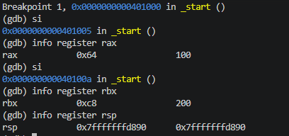
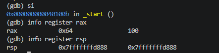
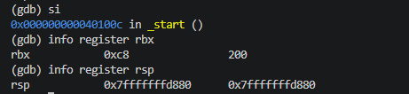
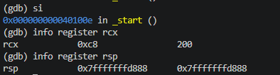
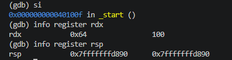
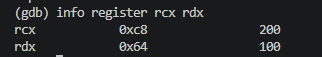

# 01.asm - Basic Stack Operations (push and pop)
## Introduction
This program demonstrates the basic operations of the stack in x86-64 assembly  language. It shows how values stored in CPU registers can be pushed onto the stack and later retrieved using the POP instruction
The program uses the rax, rbx, rcx and rdx registers to demonstrate how the stack works to the Last In, First Out principle

## Stack Operations
### Initialising registers
The first mov instruction stores 100 in rax, while the second mov stores 200 in rbx. At this point, no stack operations have taken place, so rsp remains unchanged

### Pushing values
The push instruction places a value onto the stack. First, push rax places 100 onto the stack. Since this is a 64 -bit program, rsp decreases by 8 bytes

Next push rbx places 200 onto the stack and rsp decreases by another 8 bytes

The No Operation does not perform any operation on the registers or stack

### Popping values
The pop instruction retrieves the value at the top of the stack and places it into the specified register
First, pop rcx retrieves 200 and stores it in rcx. rsp increases by 8 bytes.

Next, pop rdx retrieves 100 and stores it in rdx. rsp increases by another 8 bytes and returns to its original position.

### Program termination
The program uses the Linux exit system call to terminate with status code 0

## RSP Changes
In a 64-bit program, each push decreases rsp by 8 bytes, while each pop increases it by 8 bytes.

## Conclusion
The program demonstrates the LIFO principle of the stack. PUSH decreases rsp by 8 bytes, while POP increases it by 8 bytes. After both values are retrieved, rsp returns to its original position.
