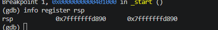
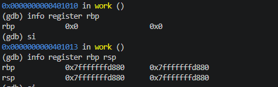
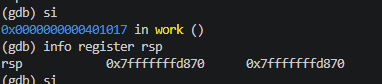
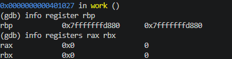
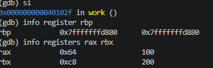

# 02.asm - Stack and Local Variables
## Introduction 
This program demonstrates how the stack is used to store local variables and manage function calls. It uses rsp and rbp to allocate, access and release stack memory

## Stack Operations
### Calling the function
call work -> the CALL instruction pushes the return address onto the stack and transfers execution to the work function. rsp decreases by 8 bytes

### Setting up the stack frame
push rbp saves the previous base pointer.
mov rbp, rsp establishes a reference point for local variables
sub rsp, 16 reserves 16 bytes of stack space for two variables

### Storing local variables
mov qword [rbp - 8], 100
mov qword [rbp - 16], 200
The program stores 100 and 200 in the allocated stack space, using rbp-relative addresses

### Retrieving values
mov rax, [rbp - 8]
mov rbx, [rbp - 16]
The values are retrieved from the stack into the rax and rbx respectively. rax receives 100, while rbx receives 200

### Restoring the stack
mov rsp, rbp releases the 16 bytes allocated for local variables
pop rbp restores the previous base pointer
ret retrieves the return address and returns execution to _start

## Conclusion
This program demonstrates how the stack manages function calls and local variables. rsp changes as memory is allocated and released, while rbp provides a stable reference point for accessing local variables.

The function restores the stack before returning, demonstrating proper stack frame management.