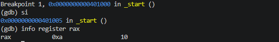
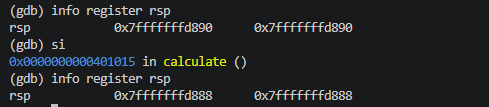
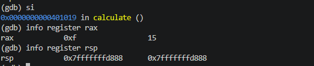
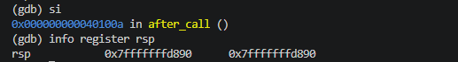

# 03.asm - Using CALL and RET Instructions
## Introduction
This program demonstrates how CALL and RET use the stack to manage function calls and return addresses. It also shows how a function can modify a register passed from the calling code.

## Stack Operations
### Initialising rax
mov rax, 10 - the value 10 is stores in rax

### Calling the function
call calculate - CALL pushes the return address onto the stack and transfers execution to calculate. rsp decreases by 8 bytes

### Modifying the register
add rax, 5 - The function adds 5 to RAX, changing its value from 10 to 15. This instruction does not modify the stack.

### Returning from the function
ret - RET retrieves the return address from the stack and resumes execution after the CALL instruction. RSP increases by 8 bytes, returning to its original value. 

### Continuing execution
The program continues at after_call, where the NOP instruction performs no operation. RAX still contains 15 before the program exits.

## Conclusion 
This program demonstrates how CALL pushes a return address onto the stack and RET retrieves it to resume execution. CALL decreases RSP by 8 bytes, while RET increases it by 8 bytes. It also shows that changes made to RAX inside a function remain available after returning to the caller.
