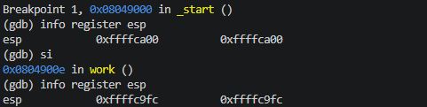
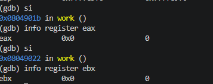
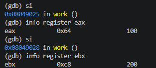
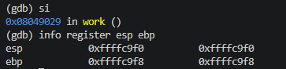
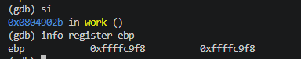

# 04.asm – Stack and Local Variables (32-bit)
## Introduction
This program demonstrates how a 32-bit stack is used to manage function calls and store local variables. It uses esp as the stack pointer and ebp as the base pointer to access variables stored on the stack.

## Stack Operations
### Calling the function
call work - CALL pushes the return address onto the stack and transfers execution to work. esp decreases by 4 bytes.

### Setting up the stack frame
push ebp - saves the previous base pointer

mov ebp, esp - establishes a reference point for local variables

sub esp, 8 - allocates 8 bytes for two local variables

### Storing local variables
mov dword [ebp - 4], 100
mov dword [ebp - 8], 200
The program stores 100 and 200 in the allocated stack space. Each variable occupies 4 bytes.

### Retrieving values
mov eax, [ebp - 4]
mov ebx, [ebp - 8]
The values are retrieved into eax and ebx respectively. eax receives 100, while ebx receives 200.

### Restoring the stack
mov esp, ebp - releases the allocated local variable space

pop ebp - restores the previous ebp value

ret - retrieves the return address and resumes execution at _start

## Conclusion
This program demonstrates how a 32-bit stack manages function calls and local variables. esp decreases by 4 bytes for PUSH and increases by 4 bytes for POP. The function allocates 8 bytes for local variables and restores the stack before returning.

