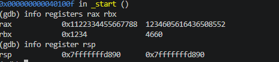
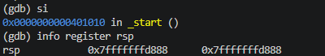
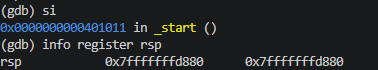
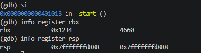
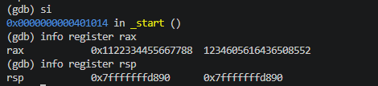

# 05.asm – Stack Operations with Hexadecimal Values
## Introduction
This program demonstrates how the stack stores and retrieves 64-bit hexadecimal values using PUSH and POP instructions. It illustrates the LIFO principle

## Stack Operations
### Initialising registers
mov rax, 0x1122334455667788 
mov rbx, 0x1234
The stack has not been modified

### Pushing values
push rax

push rbx

The values are pushed onto the stack. Each PUSH decreases rsp by 8 bytes. rbx's value becomes the top of the stack because it was pushed last

### Popping values
pop rbx - the first POP retrieves 0x1234 into rbx, rsp increases by 8 bits

pop rax - the second retrieves 0x1122334455667788 into rax, rsp increases by 8 bits

### Program termination
The program uses the Linux exit system call to terminate with status code 0. The nop instruction performs no operation and does not affect the stack.

## Conclusion
This program demonstrates how hexadecimal values are stored and retrieved using the stack. It confirms the LIFO principle, where the last value pushed is the first one popped. Both registers recover their original values after the POP operations.