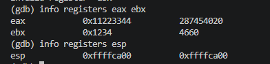
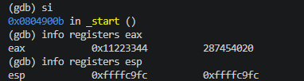
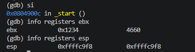
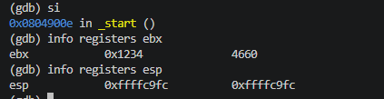
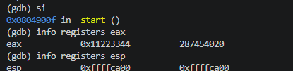

# 06.asm - Stack Operations with Hexadecimal Values (32-bit)
## Introduction
This program demonstrates how a 32-bit stack stores and retrieves hexadecimal values using PUSH and POP instructions. It follows the Last In, First Out principle.

## Stack Operations
### Initialising registers
mov eax, 0x11223344
mov ebx, 0x1234

### Pushing values
push eax - 0x11223344 is pushed onto the stack and esp decreases by 4 bytes

push ebx - 0x1234 is pushed onto the stack and esp decreases by 4 bytes

### Popping values
pop ebx - the first POP retrieves 0x1234 into ebx, esp increases by 4 bytes

pop eax - the next POP retrieves 0x11223344 into eax, esp increases by another 4 bytes

### Program termination
The program uses the 32-bit Linux exit system call (int 0x80) to terminate with status code 0. The NOP instruction performs no operation and does not affect the stack.

## Conclusion
This program demonstrates how a 32-bit stack temporarily stores and restores register values. It confirms the LIFO principle and shows how PUSH and POP operations affect esp.